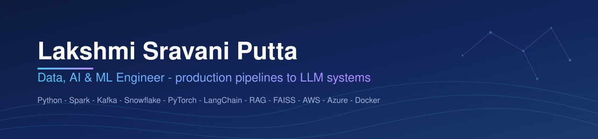

<h1 align="center">Hi, I'm Sravani 👋</h1>

<b>AI/ML Data Engineer @ MEEAMI Technologies — Python, SQL & PyTorch; RAG/LLM systems, built in public one commit at a time.</b>

  
  
  

  
  
  

Data Engineering · Data Science / ML · Data Analytics &nbsp;|&nbsp; Atlanta metro, remote anywhere in the US &nbsp;|&nbsp; available in two weeks

---

## 🚀 What I'm about

- 💼 **AI/ML Data Engineer at MEEAMI Technologies** — LLMs, RAG & conversational AI
- 🔭 I ship **small, runnable, documented projects** — real code with real logs, no vaporware
- 📅 **One Python exercise every day** in [python-daily](https://github.com/sravanni369/python-daily) — data pipelines, ML patterns, LLM building blocks
- 🧠 Currently deep in **PyTorch** — latest: a neural network that [scores 98/100 on the FizzBuzz interview](https://github.com/sravanni369/neural-fizzbuzz)
- 📊 Day job muscle: **SQL, data quality, and testing** — I find the row that breaks the report
- 🎓 Indiana Wesleyan University · certifications from Microsoft, Google Cloud, MathWorks & Coursera below

## 🛠️ Tech stack

  
  
  
  
  
  
  

  
  
  
  
  
  

  
  
  
  

  
  
  
  

## 📌 Featured projects

**Data engineering & SQL**

| Project | What it proves |
|---------|----------------|
| 🧾 [claims-data-quality](https://github.com/sravanni369/claims-data-quality) | Config-driven data-quality checks for healthcare CSVs: orphan keys, duplicates, range violations, code formats, date logic. Stdlib only |
| 🗄️ [sql-drill](https://github.com/sravanni369/sql-drill) | A fresh randomized healthcare database every session, graded questions, your result set checked against hidden reference queries |
| 🧰 [data-file-toolkit](https://github.com/sravanni369/data-file-toolkit) | CSV/JSON conversion and validation CLI, stdlib only, tested |
| 📅 [python-daily](https://github.com/sravanni369/python-daily) | One runnable exercise a day: data pipelines, data quality, sqlite3, log parsing, PyTorch drills |

**Data science & evaluation rigour**

| Project | What it proves |
|---------|----------------|
| 👶 [birthweight-leakage-pytorch](https://github.com/sravanni369/birthweight-leakage-pytorch) | Target leakage caught: one column takes the model from 62.6% to a perfect 100% / AUC 1.000 |
| 🩺 [maternal-risk-pytorch](https://github.com/sravanni369/maternal-risk-pytorch) | 55% duplicate rows. Naive split shows +37.9 points of "skill", honest dedup shows +8.9 |
| 🚫 [abuse-detection-shortcut](https://github.com/sravanni369/abuse-detection-shortcut) | Mask 25 tokens and the classifier drops below its own majority baseline. Frequency-matched control included |
| 🎗️ [cervical-screening-pytorch](https://github.com/sravanni369/cervical-screening-pytorch) | The baseline beat my model, 93.6% to 87%. Published as-is rather than tuned until it looked better |

**ML, LLM & retrieval**

| Project | What it proves |
|---------|----------------|
| 📚 [hands-on-llm-verified](https://github.com/sravanni369/hands-on-llm-verified) | Reproduces O'Reilly's *Hands-On LLMs* against 2026 libraries, 42/42 verified, and finds a fix that silently drops weighted F1 from 0.80 to 0.33 |
| ⚡ [sentiment-analysis-api](https://github.com/sravanni369/sentiment-analysis-api) | FastAPI service, TF-IDF + logistic regression, 84.2% held-out, 23 offline tests, Dockerized, documents its own out-of-vocabulary failure mode |
| 🔎 [tiny-rag-pytorch](https://github.com/sravanni369/tiny-rag-pytorch) | The R in RAG in ~150 lines of pure PyTorch: chunk, embed, cosine retrieve. No LangChain, no vector DB |
| 🔍 [bm25-search](https://github.com/sravanni369/bm25-search) | Zero-dependency BM25 engine in pure Python: inverted index, Lucene-style IDF, CLI, 30 pytest tests, CI on 3.9–3.12 |

## 📜 Certifications

| Certification | Issuer | Issued |
|---------------|--------|--------|
| Annotate and Analyze Objects for Vision | Coursera | Mar 2026 |
| Introduction to Generative AI for Developers with Copilot | Microsoft | Feb 2026 |
| Introduction to Image Processing | MathWorks | Feb 2026 |
| Model Training & Evaluation | Coursera | Feb 2026 |
| NVIDIA: Fundamentals of Machine Learning | Whizlabs | Feb 2026 |
| Python Programming Fundamentals | Microsoft | Feb 2026 |
| Introduction to SQL for BigQuery and Cloud SQL | Google Cloud | Jun 2025 |

Credential IDs are listed on my [LinkedIn](https://linkedin.com/in/lakshmi-sravani-p-212899272).

## 📈 GitHub stats

  

  

---

📧 <a href="mailto:sravannicareerv@gmail.com">sravannicareerv@gmail.com</a> · <a href="https://linkedin.com/in/lakshmi-sravani-p-212899272">LinkedIn</a> · <a href="https://lakshmi-sravani-portfolio.replit.app">Portfolio</a>

